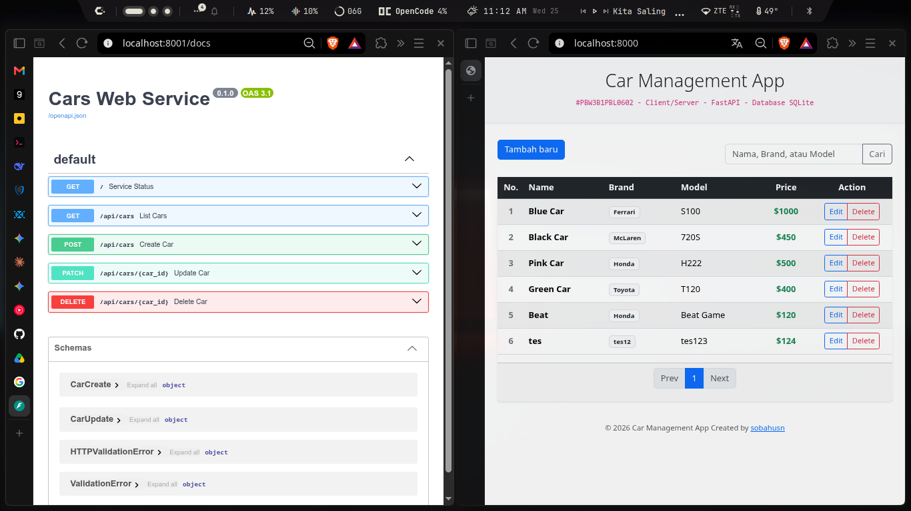

# PBL0602 - Car Management Web Service



## Struktur

```text
PBL0602/
├── client/
│   ├── main.py           # UI FastAPI dan pemanggil API
│   ├── static/
│   └── templates/
├── server/
│   └── main.py           # REST API dan akses SQLite
└── carsweb.db
```

Berbeda dari PBL0402 yang menempatkan UI dan operasi database dalam satu
`app/main.py`, PBL0602 memisahkan keduanya. `client` merender halaman dan
mengirim permintaan HTTP ke `server`; `server` menyediakan endpoint JSON dan
mengelola database. Keduanya tetap berada dalam project PBL0602.

## Menjalankan

Gunakan Python 3.12 dan `uv`.

```bash
uv sync
```

Jalankan dua terminal dari folder PBL0602. Server API harus aktif sebelum
client digunakan:

```bash
uv run uvicorn server.main:app --reload --port 8001
```

```bash
uv run uvicorn client.main:app --reload --port 8000
```

- **Aplikasi**: http://127.0.0.1:8000/
- **Dokumentasi API**: http://127.0.0.1:8001/docs

Client menggunakan `http://127.0.0.1:8001` sebagai alamat server secara
default. Ubah environment variable `CARS_API_URL` jika server berjalan di
alamat lain.
